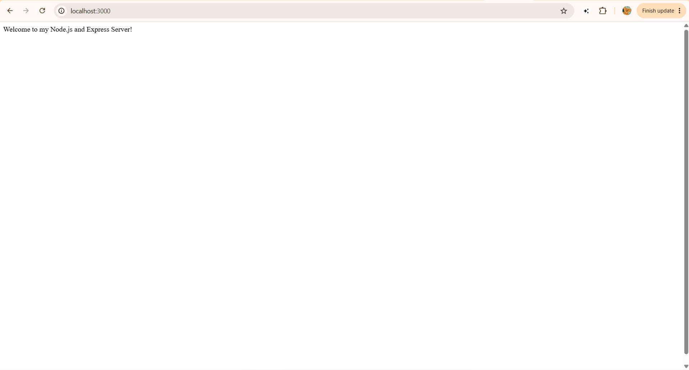
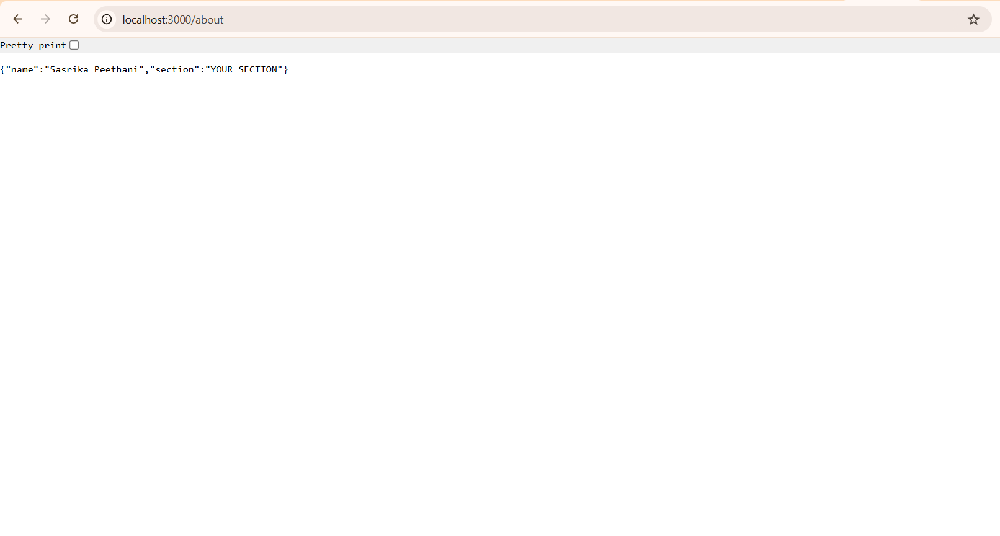
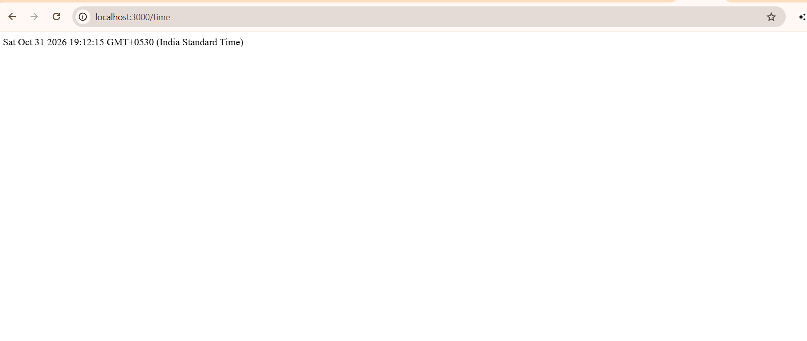
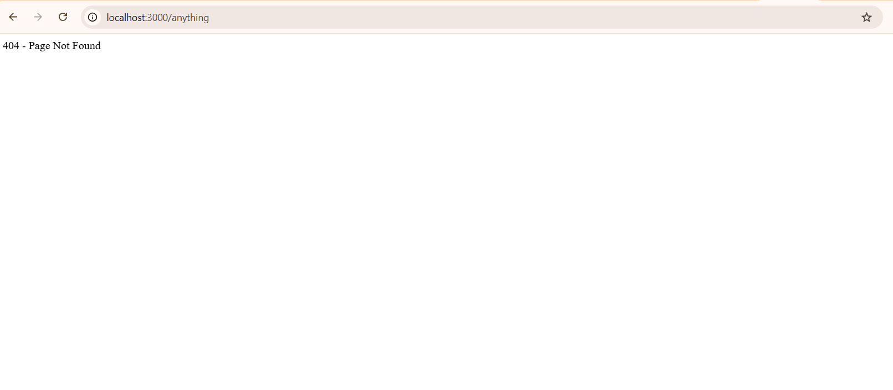

# Lab 1: Node.js and Express Server
# Lab 1: Node.js and Express Server

**Name:** Sasrika Peethani  
**Registration Number:** 252U1R1190  
**Section:** CSE CORE 2D

## Live Link


https://backend-development-labs-ajao.onrender.com

## Objective

The objective of this lab is to understand the basics of Node.js and Express.js by creating a simple web server using the built-in HTTP module and Express.js, and implementing different routes with appropriate status codes.

## Technologies Used

- Node.js
- Express.js
- JavaScript

## Project Setup

The project was initialized using:

```bash
npm init -y
```

Express was installed using:

```bash
npm install express
```

The `package.json` file stores information about the project, including its name, version, dependencies, and scripts. The `node_modules` folder contains the installed project dependencies.

## How to Run

### 1. Install Node.js

Make sure Node.js and npm are installed on your system.

### 2. Install dependencies

```bash
npm install
```

### 3. Run the Express server

```bash
node server.js
```

The server will run at:

```text
http://localhost:3000
```

## Environment Variables

No environment variables are required for this project.

## Endpoints

| Method | Path | Description | Status Code |
|--------|------|-------------|-------------|
| GET | `/` | Returns a welcome message | 200 |
| GET | `/about` | Returns name and section in JSON format | 200 |
| GET | `/time` | Returns the current date and time | 200 |
| GET | Unknown path | Returns a Page Not Found message | 404 |

## Screenshots

### Home Route



### About Route



### Time Route



### 404 Route



## Problems Faced and Solutions

Initially, Node.js was not installed on the system, so the `node` and `npm` commands were not recognized. After installing Node.js, PowerShell blocked the npm script because of the execution policy. This was solved by using `npm.cmd`.

Another issue was configuring Git for the first commit. Git required a username and email before creating a commit, so the Git user configuration was set successfully.

I also learned how to create routes using Express and return appropriate status codes for valid and invalid routes.

## Conclusion

This lab helped me understand the fundamentals of Node.js and Express.js, including creating a server using the HTTP module, creating an Express server, defining routes, sending JSON and text responses, and handling unknown routes with a 404 status code.